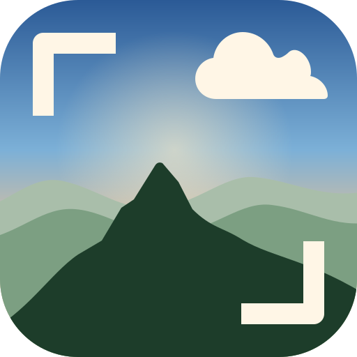
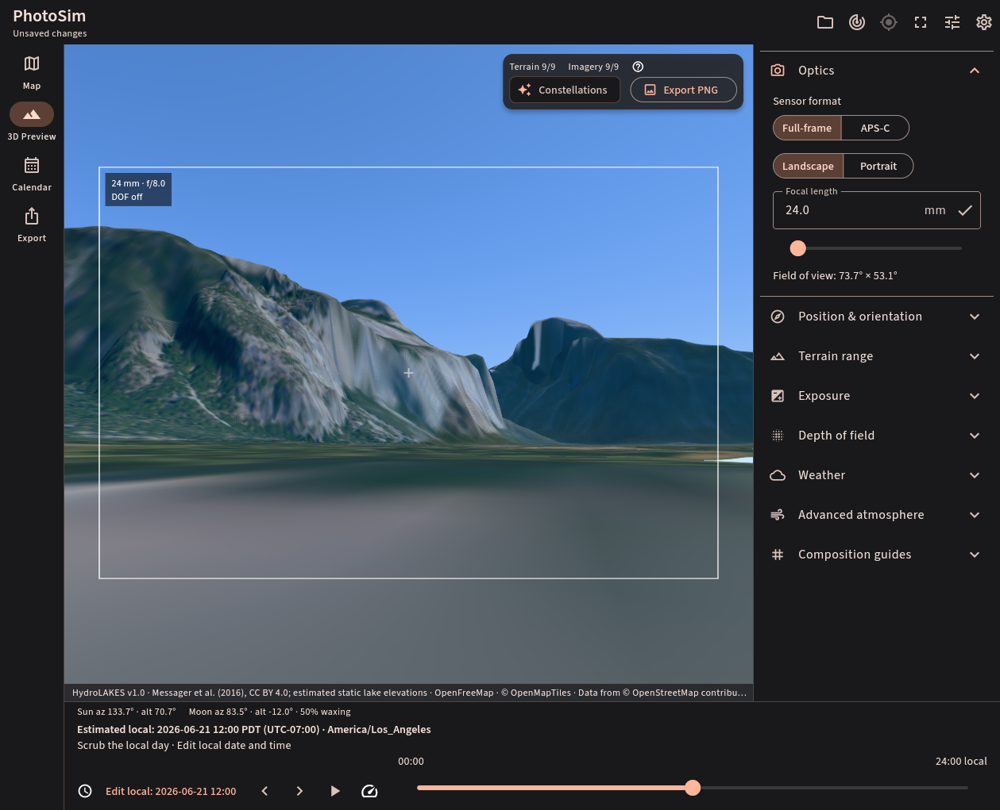
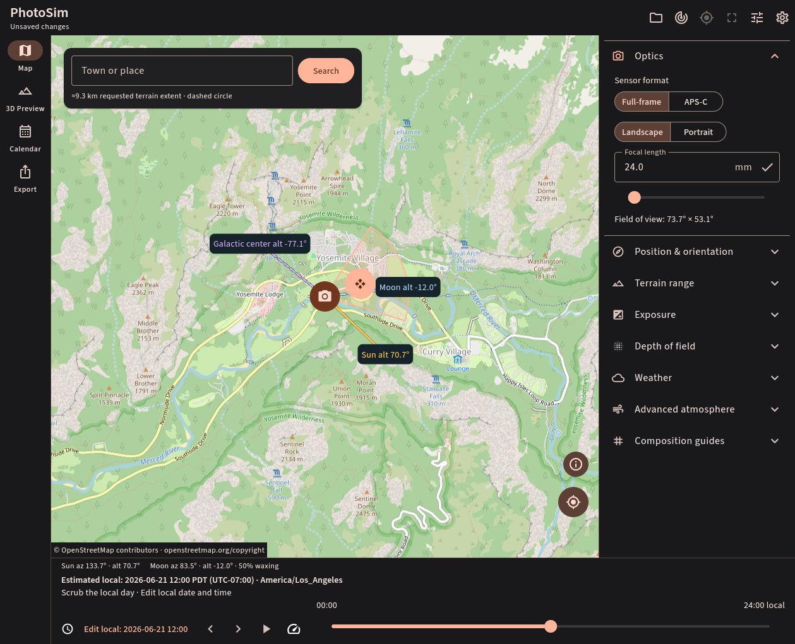
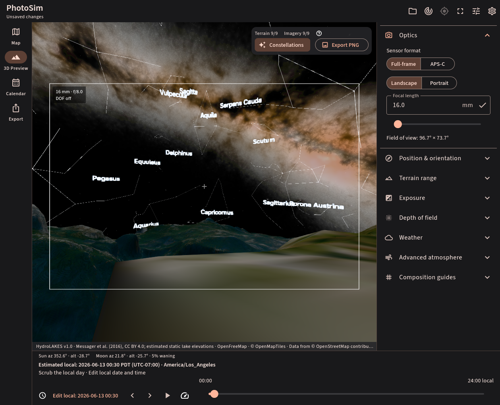
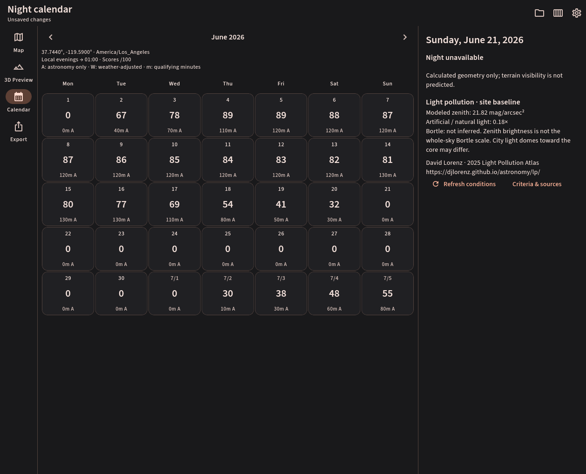
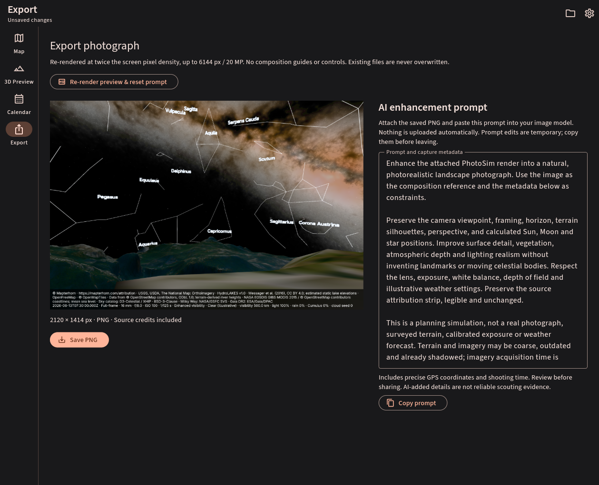
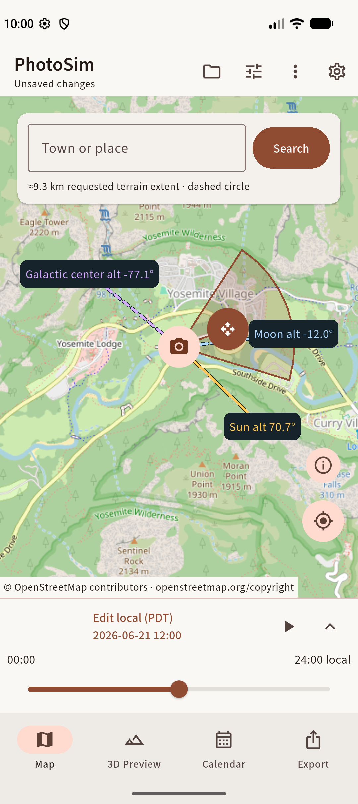
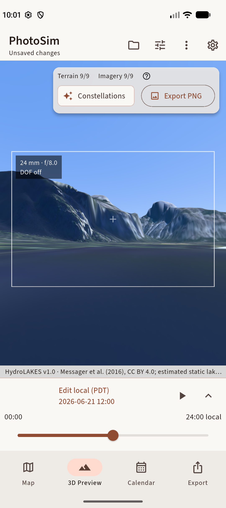
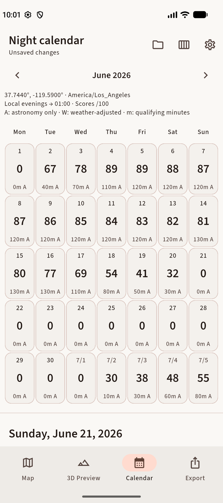

<p align="center">
  
</p>

<h1 align="center">PhotoSim</h1>

<p align="center">
  <b>Scout landscape and night-sky photos before you leave home.</b><br>
  Put a camera anywhere on the map, see what your lens would see over real terrain,
  and find the right night for the Milky Way.
</p>

<p align="center">
  <a href="https://github.com/Alchemist-Aloha/PhotoSim/releases/latest">Download</a> ·
  <a href="https://alchemist-aloha.github.io/PhotoSim/">Website</a> ·
  <a href="#quick-start">Quick start</a> ·
  <a href="#build-from-source">Build from source</a>
</p>

<p align="center">
  
</p>

PhotoSim is a free, open-source photography planner for **Linux, Windows, and
Android**. It pairs real elevation data and aerial/satellite imagery with
offline astronomy so you can figure out where to stand, where to aim, and when
to go before you pack your bag. No account, subscription, or API key required.

## What you can do

| | |
|---|---|
|  | **Plan on the map.** Search for a place, tap to drop your camera, and drag to aim. The field-of-view wedge matches your sensor and lens, and Sun, Moon, and Galactic-center bearings show where the light is coming from. |
|  | **See the view in 3D.** Real terrain, satellite imagery, lakes and rivers, and a sky with the Sun, Moon, planets, 5,000+ stars, and the Milky Way—all at the exact time and place you choose. Scrub through the day or hit play to watch the sky move. |
|  | **Pick the right night.** The night calendar scores each evening for Milky Way photography based on moonlight, darkness, light pollution at your spot, and an optional weather forecast. |
|  | **Export your shot.** Render a high-resolution PNG with data credits, plus a ready-to-copy scene prompt if you want to feed it into an AI image tool. |

**On your phone or tablet too.** The Android app has the same features with a
touch-friendly layout: drag to aim, pinch to zoom.

<p align="center">
  
  
  
</p>

### Feature highlights

- **Real camera optics:** full-frame and APS-C sensors, 8–600 mm lenses, landscape or
  portrait orientation, aperture-linked depth of field, ISO/shutter/exposure, and white balance.
- **Accurate sky:** Sun, Moon (with phase), the seven naked-eye planets, stars,
  constellations, and the Milky Way—all calculated offline for any date from 1900 to 2100.
- **Local time that makes sense:** dates and times use the camera location's
  time zone, with daylight saving handled automatically.
- **Weather and atmosphere:** clear, cloudy, fog, and rain presets, moving
  procedural clouds, and adjustable visibility. These are just for visual reference, not a forecast.
- **Composition aids:** rule-of-thirds grid, level, crosshair, fullscreen preview, and
  one-click aiming at the Sun, Moon, a planet, or the Galactic center.
- **Save and resume:** save plans as files to reopen later. PhotoSim also
  brings back your last session when you reopen it.
- **Quality presets:** Performance, Balanced, or High, depending on your GPU.

## Install

Download the latest build from the
[Releases page](https://github.com/Alchemist-Aloha/PhotoSim/releases/latest).

| Platform | File | How to install |
|---|---|---|
| **Debian / Ubuntu** | `PhotoSim-<version>-x86_64.deb` | `sudo apt install ./PhotoSim-*.deb` |
| **Arch Linux** | `PhotoSim-<version>-x86_64.pkg.tar.zst` | `sudo pacman -U PhotoSim-*.pkg.tar.zst` |
| **Any Linux** | `PhotoSim-<version>-x86_64.AppImage` | `chmod +x PhotoSim-*.AppImage`, then run it |
| **Windows 10/11** | `PhotoSim-<version>-windows-x64-setup.exe` | Run the installer (no admin rights needed) |
| **Windows (portable)** | `PhotoSim-<version>-windows-x64.zip` | Extract and open `photosim.exe` |
| **Android 10+** | `PhotoSim-<version>-arm64-v8a.apk` | Open the APK on your device (most phones use arm64) |

**Requirements:** a reasonably recent GPU and driver (PhotoSim uses
Flutter's Impeller/GPU backend) and an internet connection the first time you load
maps, terrain, or imagery. Places you've already visited stay cached locally.

## Quick start

1. **Find your spot.** On the **Map** tab, search for a town or landmark,
   or just pan around. The map starts at Yosemite.
2. **Place the camera.** Click or tap the map to drop it. Drag the camera marker to move it,
   and drag its green handle to aim.
3. **Choose your lens.** Under **Optics**, pick a sensor and focal length. The map
   wedge updates to match.
4. **Look through it.** Switch to **3D Preview**. Drag to look around, pinch (on touch) or use
   the focal-length slider to zoom, or click the view and hold **W A S D** to walk around on desktop.
5. **Set the time.** Drag the timeline slider at the bottom, or use **Edit local** to
   type an exact date and time. Press ▶ to watch the Sun, Moon, and stars move.
6. **Find a dark night.** Open the **Calendar** tab to see which evenings are best for
   the Milky Way at that spot.
7. **Save or export.** Click the folder icon to save your plan, or head to **Export** to
   render a PNG.

Tip: turn on **Constellations** in the 3D preview if you want help reading the night sky.

## Good to know

PhotoSim is a **planning aid, not a photograph**. Keep a few limits in mind:

- **Geometry is the reliable part.** Camera position, field of view, and Sun/Moon/star
  positions are calculated. Lighting, exposure, clouds, and night-sky brightness
  are approximations.
- **Terrain and imagery come from free public datasets** (roughly 10–30 m terrain in most places,
  finer in some regions). Small rock formations and distant horizons may not be exact,
  and satellite imagery can be several years old with shadows already baked in.
- **Weather presets are just for show.** The calendar can pull a free Open-Meteo
  forecast, but the 3D view doesn't render live weather.
- **Local time zones** are estimated from the camera's coordinates and work
  for 1970–2037. Outside that range, use UTC.
- **Android:** tested on emulators so far. Real-world performance depends on your phone's GPU.

For details, see the docs on [astronomy](docs/astronomy.md),
[terrain](docs/data-sources/terrain.md), [imagery](docs/data-sources/imagery.md),
[water](docs/data-sources/water.md), [night sky](docs/data-sources/night-sky.md),
[clouds](docs/clouds.md) and the [night calendar](docs/night-calendar.md).

## Privacy and data sources

Everything runs on your device. PhotoSim has no account, analytics or paid API.

- **Map:** [OpenStreetMap](https://www.openstreetmap.org/) tiles.
- **Place search:** [Photon](https://github.com/komoot/photon). Only the text you
  search for is sent, never your camera location or plans.
- **Terrain:** [Mapterhorn](https://mapterhorn.com/) (Copernicus GLO-30 and regional
  elevation models), with Mapzen and optional NASA fallbacks.
- **Imagery:** USGS NAIP (USA), IGN (France), swisstopo (Switzerland), and EOX
  Sentinel-2 or NASA Landsat elsewhere.
- **Water:** HydroLAKES, OpenFreeMap/OpenStreetMap rivers and NASA/OSM ocean masks.
- **Forecasts:** [Open-Meteo](https://open-meteo.com/), only when you use the calendar.

Saved plans are plain, unencrypted JSON files on your device. Exported PNGs and
prompts include precise GPS coordinates and time, so check them before sharing.
Downloaded data is cached locally (512 MiB by default, adjustable under
**Settings → Storage**).

## Build from source

You need [Flutter](https://docs.flutter.dev/get-started/install) **3.47.1 or newer**.

**Linux** (also needs Clang, CMake, Ninja and the GTK 3 development libraries):

```sh
flutter pub get
flutter run -d linux
```

**Android** (Android SDK, API 29+ device or emulator):

```sh
flutter pub get
flutter run -d <device-id>
flutter build apk --release   # → build/app/outputs/flutter-apk/app-release.apk
```

**Windows** (Visual Studio C++ tools; Inno Setup 6 for the installer):

```powershell
python tool/build_release.py windows --installer
```

Platform notes: [Android](docs/android.md) · [Windows](docs/windows.md) ·
[Releases and signing](docs/releases.md)

<details>
<summary><b>Linux display notes</b></summary>

PhotoSim prefers X11 (XWayland on Wayland desktops) and falls back to native
Wayland. This avoids an NVIDIA/native-Wayland freeze. Set `GDK_BACKEND=wayland` to
use native Wayland, or `GDK_BACKEND=x11` to force XWayland. On Hyprland and niri,
the GTK title bar is hidden automatically. When distributing a build, ship the whole
`build/linux/x64/release/bundle/` directory, not just the executable.

</details>

<details>
<summary><b>For contributors: checks and tests</b></summary>

```sh
dart format --output=none --set-exit-if-changed lib test integration_test
flutter analyze --fatal-infos --fatal-warnings
flutter test
flutter test integration_test/linux_workflow_test.dart -d linux
flutter test integration_test/linux_imagery_test.dart -d linux
flutter test integration_test/linux_photography_test.dart -d linux
flutter test integration_test/linux_sunlight_test.dart -d linux
flutter test integration_test/linux_spec_photography_test.dart -d linux
flutter test integration_test/linux_wasd_test.dart -d linux
flutter test integration_test/linux_loading_test.dart -d linux
flutter test integration_test/startup_test.dart -d linux
flutter test integration_test/camera_light_test.dart -d linux
flutter test integration_test/water_test.dart -d linux
flutter test integration_test/linux_planning_ui_test.dart -d linux
flutter build linux --release
```

Native integration tests need a live graphical session and internet access on the
first run. They write screenshots to `build/validation/`. Screenshots in this README
are regenerated with `integration_test/showcase_test.dart` and
`integration_test/readme_showcase_test.dart`; see the
[website README](website/README.md#screenshots).

[GitHub Actions](.github/workflows/build.yml) builds all release packages and
uploads them when a `v<version>` tag is pushed.

More project docs: [implementation status](docs/implementation-status.md) ·
[performance](docs/performance.md) · [Linux MVP scope](docs/linux-mvp.md) ·
[spec progress](docs/linux-spec-progress.md) · [roadmap](docs/roadmap.md)

</details>

## License

PhotoSim is licensed under the [GNU General Public License v3.0 only](LICENSE)
(`GPL-3.0-only`). Copyright © 2026 PhotoSim contributors. Bundled third-party
components and data keep their own licenses and attribution.
